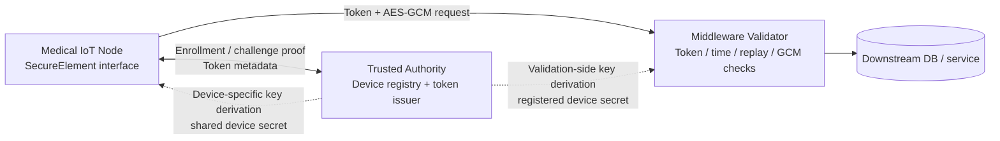
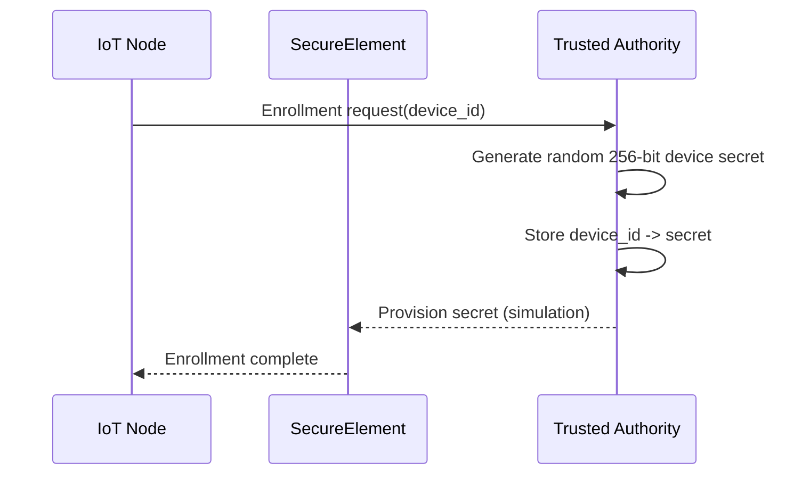
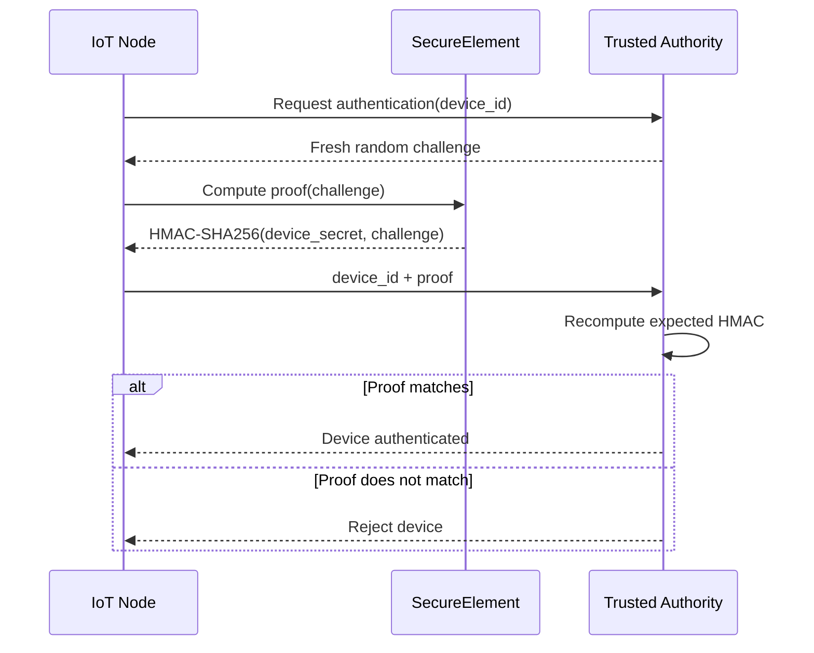
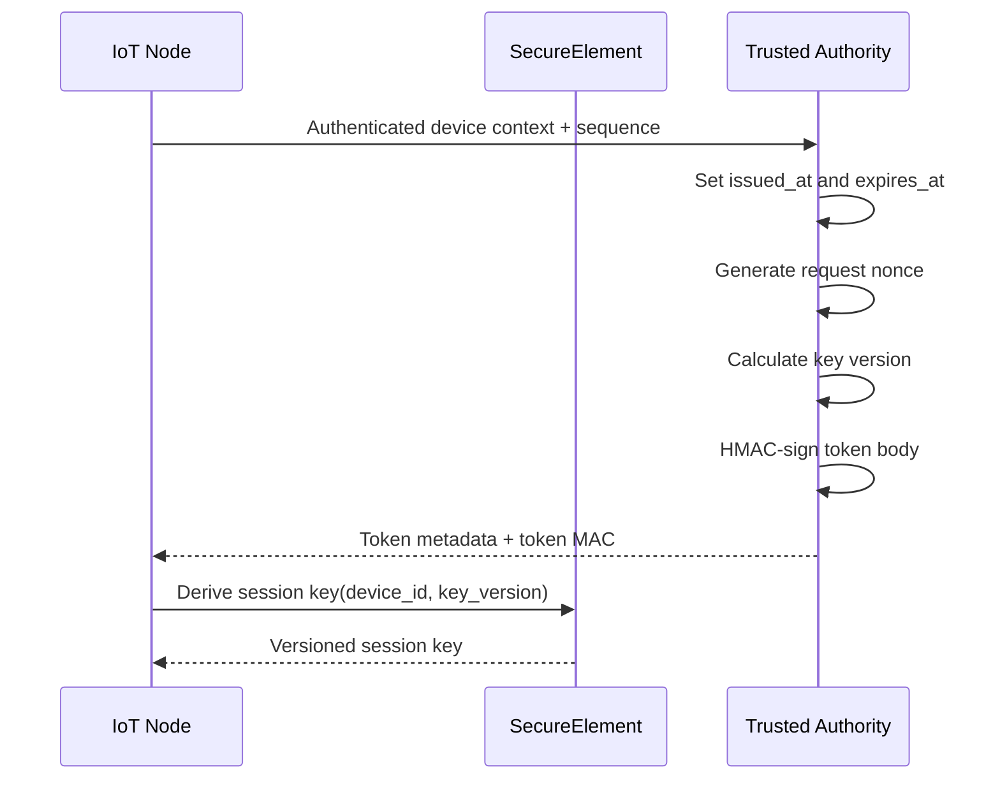
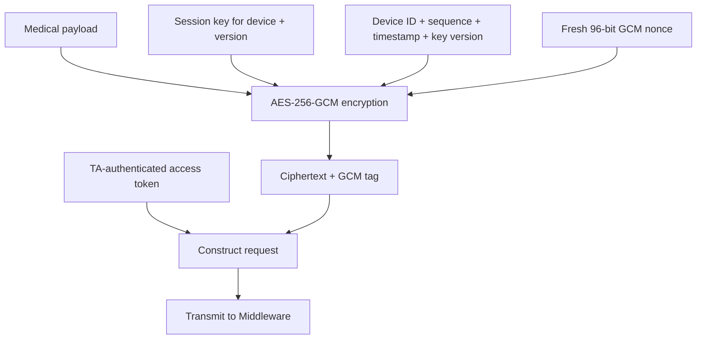
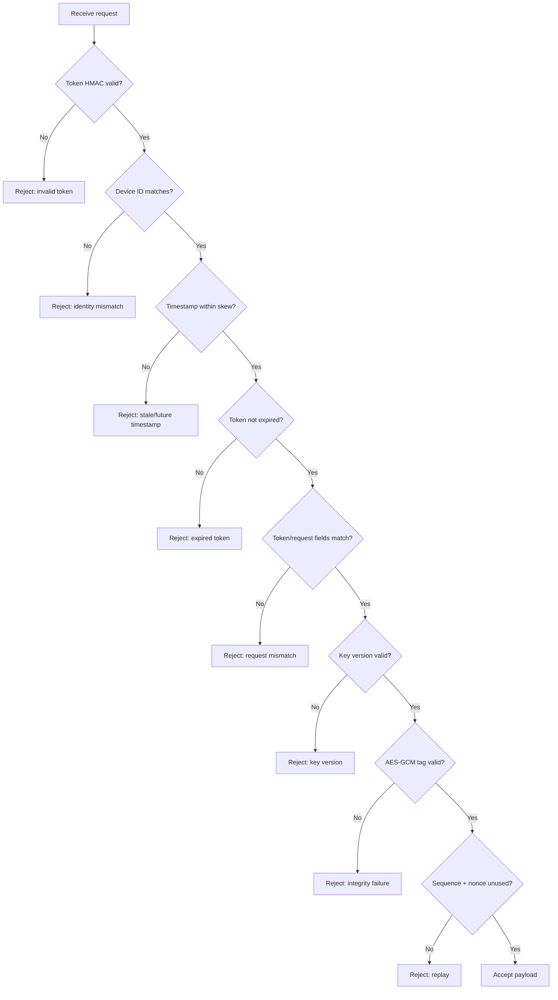
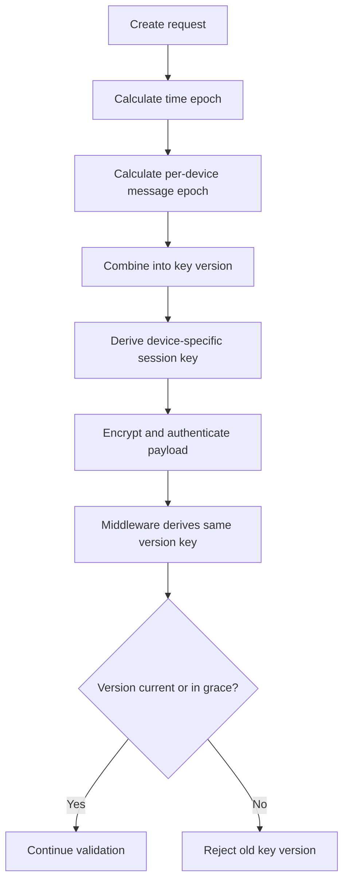

# Design and Implementation Report
## A Three-Party Authentication and Secure Data-Transfer Protocol for Medical IoT

**Project implementation:** C++17 simulation  
**Primary entities:** Trusted Authority (TA), IoT Node, Middleware (MW)  
**Cryptographic library:** OpenSSL `libcrypto`  
**Implementation status:** runnable simulation with software-emulated secure-element support

---

## Abstract

Medical Internet of Things (MIoT) environments contain resource-constrained devices that collect and transmit sensitive information through intermediate services. A system accepting data from such devices must establish device identity, authenticate requests, protect payload confidentiality and integrity, reject stale or replayed messages, and manage cryptographic keys over time. This project implements an enhanced three-party protocol consisting of an IoT Node, a Trusted Authority (TA), and a Middleware (MW). The TA enrolls devices and validates challenge-response proofs. A successfully authenticated node derives a versioned session key and sends a short-lived, TA-authenticated access token together with an AES-256-GCM-protected payload. The middleware verifies the token signature, device identity, timestamps, key version, sequence number, nonce uniqueness, and authenticated-encryption tag before accepting the message. Key versions change on both a configurable time interval and a configurable per-device message count. A bounded overlap permits in-flight requests using the immediately previous time-based key version. The implementation also includes configurable delay, packet-drop, concurrency, and attack simulation facilities for measuring behavior under different conditions. The secure-element interface is implemented using a software-emulated secret store; therefore, the project demonstrates the hardware-authentication interface and protocol flow, but does not claim physical TPM or secure-element protection. The report describes the architecture, protocol, implementation, assumptions, limitations, and a reproducible evaluation plan.

**Keywords—** Medical IoT, device authentication, middleware, access token, AES-GCM, HMAC, key rotation, replay protection, timestamp validation, secure element.

---

## 1. Introduction

Medical IoT systems connect sensors and other embedded devices to middleware and application services. These devices may produce measurements that are sensitive and operationally important. A receiver must not accept arbitrary data merely because it arrives over a network. It must establish which device is sending the data and determine whether the request is fresh, authorized, and unmodified.

The starting project supplied for this implementation was a C++17 simulation of a three-party system. Its logical entities were the Trusted Authority (TA), Node, and Middleware (MW). It simulated token issuance and validation, AES-CBC encryption, network and database delays, random failures, tampering, and concurrent workers. However, the supplied source used fixed passphrase-derived keys, did not authenticate AES-CBC ciphertext, and did not implement device proof-of-possession, strict freshness validation, replay-state tracking, or key rotation.

This implementation retains the three-party organization and the performance-simulation features while strengthening the request protocol. The intention is to create a complete and understandable final-year project implementation. It is not presented as a formally verified cryptographic protocol or as a production-ready medical platform.

### 1.1 Objectives

The implementation has the following objectives:

1. Provide a device-enrollment and device-authentication phase.
2. Require a fresh challenge-response proof before a node can send authenticated data.
3. Issue short-lived access tokens whose contents are integrity-protected by the TA.
4. Encrypt and authenticate medical-data payloads.
5. Reject expired, stale, future-dated, replayed, or out-of-order requests.
6. Rotate session-key versions according to time and message-count limits.
7. Retain a bounded transition window for in-flight requests during time-based rotation.
8. Simulate attacks and unreliable network conditions.
9. Measure per-node latency, success rate, dropped requests, and rejection reasons.

### 1.2 Scope

The software simulates the authentication and data-transfer portion of an MIoT architecture. It does not implement a clinical application, patient database, device firmware, real network sockets, real medical sensors, or a production identity-management service. The delays are simulated using thread sleeps. A physical secure element is not required to compile or run the supplied project.

---

## 2. System Model and Architecture

### 2.1 Entities

**A. IoT Node (N)**  
The node represents a medical sensor or connected medical device. During enrollment, it receives a unique per-device secret. In the simulation, the secret is held by the `SecureElement` abstraction. The node proves possession of that secret by computing an HMAC over a fresh challenge. After authentication, it derives a session key for the current key version, constructs an authenticated request, and encrypts its payload.

**B. Trusted Authority (TA)**  
The TA is the trust anchor for the simulation. It creates device credentials during enrollment, stores the device secret in its registry, verifies device challenge-response proofs, signs access-token contents using HMAC-SHA-256, and derives the same versioned session key as the device for middleware validation. The token-signing key is generated randomly when the process starts.

**C. Middleware (MW)**  
The middleware is the request-validation point between devices and downstream services. It validates the token, checks identity and timestamps, confirms the key version, authenticates/decrypts the payload, and checks replay state. The simulation represents a database or downstream processing step using a configurable delay after request processing.

### 2.2 High-level architecture diagram



The dotted links represent logical cryptographic relationships inside the simulation. The executable is a single-process program, so these are not real network connections. The TA and MW are represented by C++ objects, and the node is represented by a worker routine.

### 2.3 Trust boundaries

- The node must protect its enrolled device secret. In the default implementation this protection is only simulated by encapsulating the secret in a C++ object.
- The TA is trusted to enroll devices, issue valid tokens, and protect its token-signing key and device registry.
- The MW is trusted to execute validation correctly and protect its replay state.
- The communication path is treated as untrusted. Token fields and ciphertext may be observed or modified; token integrity and payload integrity are therefore checked at the receiver.
- The operating-system clock is assumed to be sufficiently synchronized for the configured clock-skew limit. The code does not implement a clock synchronization protocol.

---

## 3. Protocol Parameters and Cryptographic Primitives

### 3.1 Cryptographic primitives

| Purpose | Mechanism in implementation | Notes |
|---|---|---|
| Device proof-of-possession | HMAC-SHA-256 | Challenge-response using the per-device secret |
| Access-token integrity | HMAC-SHA-256 | The token is authenticated, not encrypted |
| Payload confidentiality and integrity | AES-256-GCM | 256-bit key, 96-bit random nonce, 128-bit tag |
| Session-key derivation | HKDF-style HMAC-SHA-256 extract/expand | Domain-separated by device ID and key version |
| Random values | OpenSSL `RAND_bytes` | Used for secrets, challenges, nonces, and GCM IVs |
| Equality checks for MACs | `CRYPTO_memcmp` | Avoids ordinary early-exit byte comparison |

The source implements a compact HKDF-style construction using HMAC-SHA-256. It performs an extract step with a fixed salt and one expand block containing a domain-separated context string and counter byte. The resulting 32-byte value is used as an AES-256 key. A production implementation should use a fully specified, independently reviewed HKDF implementation and document its salt and context construction precisely.

### 3.2 Important parameters

| Parameter | Default | Purpose |
|---|---:|---|
| Maximum clock skew | 5 seconds | Permitted difference between receiver time and token/request timestamp |
| Access-token lifetime | 60 seconds | Maximum token validity period after issuance |
| Replay-cache TTL | 120 seconds | Retention period for accepted nonces |
| Time-based key rotation | 900 seconds | Creates a new key-version epoch every 15 minutes |
| Message-count rotation | 10,000 messages/device | Changes key version after this many sequential messages |
| Previous-key grace | 30 seconds | Permits an immediately previous time epoch briefly during rollover |
| GCM nonce length | 12 bytes | Standard 96-bit GCM nonce length |
| GCM authentication tag | 16 bytes | 128-bit tag |
| Device secret | 32 random bytes | Unique secret generated at simulated enrollment |

These values are configurable demonstration defaults, not universal medical-IoT standards. A deployment would select them based on device clock quality, network latency, expected message frequency, risk assessment, and operational requirements.

### 3.3 Token structure

The token body contains the following fields, serialized as pipe-separated text:

```text
<device_id>|<sequence>|<issued_at>|<expires_at>|<key_version>|<nonce>|<hmac>
```

Where:

- `device_id` identifies the enrolled node.
- `sequence` is the per-device increasing message number.
- `issued_at` is the TA issuance time in Unix seconds.
- `expires_at` is the token expiration time in Unix seconds.
- `key_version` identifies the time/message-count-derived session-key version.
- `nonce` is a fresh random value associated with this request.
- `hmac` authenticates all preceding token fields using the TA token-signing key.

The token is not encrypted. Its fields are metadata and do not contain the medical payload. HMAC protects token integrity and origin within the trust model; it does not provide confidentiality.

### 3.4 Session-key version calculation

The implementation combines a time epoch and a per-device message epoch:

\[
V = \left\lfloor \frac{T_{issued}}{R_t} \right\rfloor \times 10^9
  + \left\lfloor \frac{S-1}{R_m} \right\rfloor
\]

Where:

- \(T_{issued}\) is the issuance timestamp,
- \(R_t\) is the time-based rotation interval in seconds,
- \(S\) is the per-device sequence number, and
- \(R_m\) is the message-count rotation threshold.

The large multiplier keeps the time component separate from the message component for the expected configuration range. The same calculation is performed by the node and MW. A different version produces a different derived session key.

The session key is derived using a device-specific secret and a context string:

\[
K_{session} = HKDF(K_{device},\ "medical-iot/session/" \parallel ID \parallel V)
\]

The TA can derive the same key from the registered device secret. The node derives it through the `SecureElement` interface. The middleware asks the TA-side validator to derive the corresponding key. In a real distributed deployment, this would be implemented as a hardware-backed derivation operation or as an authenticated key-establishment protocol; it would not be a direct C++ method call.

---

## 4. Detailed Protocol Flows

### 4.1 Phase 1 — Device enrollment

The enrollment process creates a unique credential for each device.

1. The TA receives a device identifier.
2. The TA generates a random 256-bit device secret using OpenSSL's cryptographically secure random generator.
3. The TA stores the secret in its device registry under that identifier.
4. The simulated device receives the secret and stores it inside the `SecureElement` object.
5. The device is now enrolled and can respond to future challenges.



**Implementation note:** this is a simplified enrollment model. It assumes that provisioning takes place over a trusted setup channel. A production enrollment system would require device manufacturing identity, certificate issuance or secure provisioning, authorization controls, audit records, revocation, and a protected provisioning channel. The simulation does not model those operational processes.

### 4.2 Phase 2 — Device challenge-response authentication

The device must prove possession of its enrolled secret before the request is created.

1. The node asks for authentication and receives a fresh random challenge (32 random bytes represented as hexadecimal text).
2. The node computes:

\[
P_N = HMAC_{SHA256}(K_{device}, Challenge)
\]

3. The node sends its device identifier and proof to the TA.
4. The TA looks up the device secret and computes the expected HMAC.
5. The TA compares the received and expected proofs using a constant-time comparison.
6. If they match, the device is authenticated. Otherwise, the device request is rejected.



The challenge is fresh for each authentication attempt. An attacker who records a previous proof should not be able to reuse it for a different challenge. This protects the authentication step against straightforward replay of a previously captured proof, assuming the device secret remains secret and the challenge is unpredictable.

### 4.3 Phase 3 — Token issuance and session-key derivation

After successful device authentication:

1. The node increments its sequence number. In this simulation, each node begins at sequence 1 and sends the configured number of sequential messages.
2. The TA-side token issuer creates an issuance timestamp and expiration timestamp.
3. A fresh random request nonce is generated.
4. The time/message key version is calculated.
5. The TA creates the token body and computes its HMAC.
6. The node derives the session key for the same device ID and key version using the secure-element interface.



The token binds the device identity, sequence, timestamps, key version, and nonce together. Changing one of these fields invalidates the HMAC.

### 4.4 Phase 4 — Payload encryption and request construction

The node encrypts the medical payload using AES-256-GCM.

Associated authenticated data (AAD) is constructed as:

```text
<device_id>|<sequence>|<timestamp>|<key_version>
```

The encryption operation is:

\[
(C, Tag) = AES\text{-}256\text{-}GCM.Enc(K_{session}, IV, M, AAD)
\]

Where \(M\) is the payload, \(IV\) is a fresh 96-bit nonce, and `Tag` is the 128-bit authentication tag. The AAD is not encrypted, but any modification to it causes authentication failure. The token's separate request nonce is used for replay tracking; the GCM IV is used by AES-GCM and is generated independently.

The node sends the following logical request:

```text
Request = {
    device_id,
    access_token,
    sequence,
    timestamp,
    key_version,
    request_nonce,
    gcm_nonce,
    ciphertext,
    gcm_tag
}
```



**Nonce requirement:** AES-GCM requires nonce uniqueness for every encryption under the same key. The simulation generates a random 96-bit nonce for every encryption. A production implementation should carefully assess collision probability and consider a robust per-key counter or a nonce-allocation design that remains safe across restarts and multiple senders. It must never reuse a GCM nonce with the same key.

### 4.5 Phase 5 — Middleware validation

The middleware validates the request in the following order:

1. Parse the token and verify its HMAC using the TA's token-signing key.
2. Confirm that the token device ID matches the request device ID.
3. Parse the sequence, issuance time, expiration time, and key version.
4. Reject if the issuance timestamp is too far in the future or too old relative to current time.
5. Reject if the token has expired.
6. Confirm that token fields match the request fields (sequence, key version, and request nonce).
7. Independently check the request timestamp against the configured clock-skew limit.
8. Recalculate the expected key version and reject mismatches.
9. Enforce the previous-time-version grace period and reject old versions outside the permitted transition window.
10. Derive the device/version session key and authenticate/decrypt the AES-GCM payload using the expected AAD.
11. Atomically check and commit the sequence number and request nonce in the replay guard.
12. Accept the payload only if every check succeeds.



The replay guard is updated only after token, timestamp, key-version, and GCM checks succeed. This ordering avoids consuming a legitimate sequence number merely because an attacker or network fault delivered a corrupted ciphertext. The replay-state update itself is protected by a mutex so concurrent workers cannot both accept the same sequence/nonce pair.

### 4.6 Phase 6 — Key rotation

The implementation rotates session-key versions through two independent counters:

- **Time-based rotation:** a new time epoch is selected every configured number of seconds.
- **Message-count rotation:** a new message epoch is selected after the configured number of messages sent by a device.

The node and middleware derive the same version value from the issuance time, sequence number, and configuration. Because the key derivation context includes the version, a new version produces a different session key.



When a time-based boundary is crossed, MW temporarily accepts a request issued under the immediately previous time epoch, but only within the configured grace interval. The token still has to satisfy timestamp and expiration checks. The grace period exists to handle a message that was created just before rotation and arrived shortly afterward. It is not an indefinite acceptance of old keys.

Message-count rotation is tested by setting `--messages-per-node` greater than `--rotate-after-messages`. For example:

```bash
./tps --nodes 2 --messages-per-node 8 --rotate-after-messages 3
```

This produces message-count key-version transitions for each node while retaining monotonically increasing sequence numbers.

**Security qualification:** this versioning scheme provides key separation between versions, but it does not provide forward secrecy against compromise of the long-term device secret. An attacker who extracts that secret and knows the derivation context may be able to derive past or future session keys. A production design requiring forward secrecy should use authenticated ephemeral key agreement (for example, ephemeral ECDH) and carefully erase old key material. Rotation alone does not establish forward secrecy.

---

## 5. Replay Protection and Time Validation

### 5.1 Timestamp checks

Let `now` be the middleware's current Unix time, `issued_at` the token timestamp, and `W` the allowed clock skew. The middleware rejects the request if:

\[
issued\_at > now + W
\]

or

\[
now - issued\_at > W
\]

It also rejects if the request timestamp differs from the receiver's current time by more than \(W\), and rejects if `now > expires_at`.

The timestamp check is deliberately strict. This makes the simulation easy to reason about, but a real deployment must account for clock drift, intermittent connectivity, sleep cycles, and synchronization failures. It should use authenticated time synchronization or another freshness mechanism where device clocks cannot be trusted. Local TTL measurement should generally use a monotonic clock; cross-device timestamp comparison requires wall-clock time.

### 5.2 Sequence number

Each device has an increasing sequence number. MW stores the highest accepted sequence for each device. A request with:

\[
S_{incoming} \leq S_{highest}
\]

is rejected. This blocks duplicate and out-of-order messages within the lifetime of the replay-state record.

### 5.3 Nonce cache

MW also stores each accepted request nonce and its acceptance time. Before accepting a request, expired nonce entries are pruned. A nonce already present in the cache is rejected. This gives a second replay check in addition to the sequence number.

The replay state is represented conceptually as:

```text
ReplayState[device_id] = {
    highest_sequence,
    nonce -> accepted_at_timestamp
}
```

The implementation protects this structure with a mutex. In a real multi-instance middleware deployment, an in-process mutex is insufficient. The state must be shared and updated atomically across instances, for example through a transactional database or a strongly consistent distributed cache.

### 5.4 Restart and persistence limitation

Replay state is held in memory and is reset when the executable exits. The simulation is therefore suitable for a single-run experiment, not a persistent replay defense across service restarts. A production system must persist sequence state or use a durable, shared replay store and define recovery behavior for device and server restarts.

---

## 6. Security Analysis

This section describes which attacks the implementation is intended to demonstrate. It is not a formal security proof.

### 6.1 Device impersonation

An attacker who does not possess the enrolled per-device secret cannot produce the expected HMAC response to a fresh random challenge, assuming the secret remains unknown and HMAC-SHA-256 is secure. The middleware does not accept a request from an unauthenticated node in the normal worker flow.

**Limitation:** the simulation provisions the secret in software and stores a copy in the TA registry. It does not demonstrate resistance to physical extraction, side-channel attacks, debug-port attacks, firmware compromise, or cloning of a real device.

### 6.2 Token modification

The TA authenticates the token body with HMAC-SHA-256. If an attacker changes the device ID, expiry, sequence number, key version, nonce, or another token field without the signing key, the HMAC verification fails.

### 6.3 Payload tampering

AES-GCM provides authenticated encryption. A change to the ciphertext, GCM nonce, tag, or authenticated associated data causes decryption/authentication to fail. The `--tamper-percent` option flips a ciphertext bit after encryption to exercise this rejection path.

### 6.4 Replay attack

The replay simulation redelivers an already accepted request. The first delivery may be accepted; the second is rejected by the per-device sequence and/or nonce check. The `--replay-percent` option controls how often this is attempted.

### 6.5 Expired-token attack

The `--expired-percent` option causes the simulator to issue tokens whose expiry is already in the past. The middleware rejects them before payload acceptance.

### 6.6 Invalid hardware proof

The `--hardware-fail-percent` option replaces a valid challenge-response proof with random bytes. The TA rejects the proof because it does not match the HMAC generated using the enrolled device secret.

### 6.7 Stale and future timestamps

The implementation checks both stale and future issuance timestamps and separately checks the request timestamp. The configured skew window prevents a request from being accepted indefinitely based only on a valid token MAC.

### 6.8 Key-version downgrade or stale-key use

The key version is included in the token MAC and the AES-GCM AAD. MW independently recalculates the expected version. A mismatched version is rejected. An immediately previous time-based version is accepted only during the bounded grace period; older versions are rejected.

### 6.9 Network failures and denial of service

The `--fail-percent` option simulates dropped requests before protocol processing. The program reports these separately from authentication rejections. The simulation does not implement rate limiting, request quotas, connection admission control, or a production denial-of-service mitigation strategy.

### 6.10 Threat coverage summary

| Threat | Implemented control | Demonstration option / expected result |
|---|---|---|
| Device impersonation | Fresh challenge + HMAC proof | `--hardware-fail-percent`; invalid proof rejected |
| Token field modification | HMAC-SHA-256 token authentication | Invalid token rejected |
| Payload tampering | AES-256-GCM authentication tag | `--tamper-percent`; integrity failure |
| Request replay | Sequence number + nonce cache | `--replay-percent`; second delivery rejected |
| Expired authorization | Token expiration timestamp | `--expired-percent`; expired token rejected |
| Stale/future timestamp | Strict clock-skew checks | Configure `--max-clock-skew`; out-of-window request rejected |
| Stale key version | Version check + bounded grace | Configure short `--rotation-seconds` and grace |
| Packet loss | Random drop simulation | `--fail-percent`; counted as network drop |
| Physical device compromise | Not implemented | Requires physical secure element/TPM and hardware testing |
| Forward secrecy | Not implemented | Requires authenticated ephemeral key agreement |
| Persistent replay state | Not implemented | Current replay cache is process-local memory |

---

## 7. Implementation Design

### 7.1 Source organization

The project intentionally remains small and uses a single primary source file to make the final-year project easy to build and explain.

| Component / class | Responsibility |
|---|---|
| `crypto` namespace | Random generation, hex conversion, HMAC, HKDF-style derivation, AES-GCM encrypt/decrypt |
| `Config` | Protocol parameters, simulation parameters, and output paths |
| `SecureElement` | Encapsulates the device secret and exposes proof/key-derivation operations |
| `TrustedAuthority` | Device registry, proof verification, token issuance/verification, session-key derivation |
| `ReplayGuard` | Per-device highest sequence and TTL-based nonce cache |
| `Middleware` | Token, timestamp, key-version, GCM, and replay validation |
| `Request` | Logical message sent by a node to MW |
| `Metrics` | Per-node latency, success, drop state, and final outcome |
| `worker` | Simulates one device's enrollment and sequential message flow |
| `main` | Parses configuration, launches workers, aggregates metrics, writes output |

### 7.2 Concurrency model

The main function creates a fixed-size pool of worker threads. An atomic counter assigns a unique simulated device index to each worker. Each worker performs its node's authentication and message sequence. The results vector is protected by a mutex. The TA registry and replay guard also protect shared state with mutexes.

The replay check and update are performed under one lock, preventing two concurrent workers from both accepting the same replay state for a device. In this particular test harness, each device is assigned to one worker, but the guard itself is written to serialize concurrent accesses.

### 7.3 Error handling

Cryptographic functions throw exceptions when OpenSSL operations fail. The worker catches exceptions and records an `internal_error` outcome rather than terminating the entire simulation. Middleware validation returns a rejection reason such as `invalid_token`, `expired_token`, `integrity_check_failed`, or `replay_detected`. These reason strings are counted in the final report.

### 7.4 Performance measurements

The simulator records:

- Per-node elapsed time in microseconds.
- Average, median, minimum, and maximum per-node elapsed time.
- Number and percentage of accepted nodes.
- Number and percentage of network drops.
- Outcome counts by rejection or acceptance reason.
- Total wall-clock time for the simulation run.

The elapsed time includes configured sleeps for node jitter, TA-to-node delay, node-to-MW delay, and downstream/database delay. Therefore, the reported latency is an end-to-end simulation latency, not just cryptographic execution time. It should not be compared directly to cryptographic microbenchmarks or real hardware measurements.

---

## 8. Build and Execution Instructions

### 8.1 Dependencies

- C++17 compiler
- OpenSSL development headers and `libcrypto`
- pthread support

On Ubuntu/Debian:

```bash
sudo apt update
sudo apt install g++ libssl-dev
```

Compile from the project directory:

```bash
g++ -std=c++17 -O2 -pthread tps.cpp -lcrypto -o tps
```

### 8.2 Basic execution

```bash
./tps --nodes 100 --workers 4
```

### 8.3 Key-rotation experiment

```bash
./tps --nodes 5 --workers 2 --messages-per-node 12 --rotate-after-messages 3
```

Each node sends twelve sequential messages. The message-count component of the key version changes after each group of three messages. Time-based rotation can be tested separately with a shorter `--rotation-seconds` value.

### 8.4 Security attack experiment

```bash
./tps \
  --nodes 200 \
  --workers 4 \
  --messages-per-node 3 \
  --tamper-percent 10 \
  --replay-percent 10 \
  --hardware-fail-percent 10 \
  --expired-percent 10 \
  --fail-percent 2
```

This command independently injects ciphertext tampering, replay attempts, invalid device proofs, expired tokens, and network drops. The percentages are probabilities applied to the corresponding simulation events; observed counts will vary because the random generator is used.

### 8.5 Output files

- `tps.txt` receives an appended human-readable report for each run.
- `results.csv` receives an appended CSV row for each run.

Use `--summary` and `--out` to select different output paths. The program does not overwrite previous results by default.

---

## 9. Testing and Validation Plan

A useful project evaluation should include a normal baseline, then change one security or network parameter at a time. Run each experiment multiple times and report averages or distributions rather than relying on a single random run.

| Test ID | Configuration | Expected behavior |
|---|---|---|
| T1 — Baseline | All attack percentages 0 | Most/all requests accepted; no intentional drops |
| T2 — Invalid device proof | `--hardware-fail-percent 100` | Every node fails device authentication |
| T3 — Payload tampering | `--tamper-percent 100` | Requests with non-empty payloads fail GCM integrity validation |
| T4 — Expired tokens | `--expired-percent 100` | Every issued token is rejected as expired |
| T5 — Replay | `--replay-percent 100` | First delivery accepted; duplicate delivery rejected |
| T6 — Message rotation | `--messages-per-node 10 --rotate-after-messages 2` | Version changes as each device crosses message thresholds |
| T7 — Time rotation | Short `--rotation-seconds`, controlled network delay | Previous epoch accepted only during grace; stale epoch rejected afterward |
| T8 — Network loss | `--fail-percent 20` | A proportion of nodes recorded as dropped before authentication |
| T9 — Concurrency | Increase nodes and workers | Throughput/wall time changes; no duplicate acceptance for one sequence |
| T10 — Clock skew | Reduce `--max-clock-skew` and increase delay | Requests outside freshness window are rejected |

### 9.1 Suggested baseline command

```bash
./tps --nodes 500 --workers 4 --messages-per-node 1 \
  --tamper-percent 0 --replay-percent 0 \
  --hardware-fail-percent 0 --expired-percent 0 --fail-percent 0 \
  --out baseline.csv --summary baseline.txt
```

### 9.2 Suggested attack command

```bash
./tps --nodes 500 --workers 4 --messages-per-node 2 \
  --tamper-percent 10 --replay-percent 10 \
  --hardware-fail-percent 10 --expired-percent 10 --fail-percent 5 \
  --out attacks.csv --summary attacks.txt
```

### 9.3 Suggested performance variables

Vary one parameter at a time:

- Number of devices: 50, 100, 500, 1,000.
- Worker count: 1, 2, 4, 8.
- Payload size: 64, 256, 512, 1,024, 4,096 bytes.
- Messages per device: 1, 10, 100.
- Network delay range and database delay range.
- Attack percentages.

For a fair comparison, use the same machine, compiler flags, OpenSSL version, payload size, worker count, and delay configuration. Run each case several times. Report the mean and standard deviation, or median and interquartile range, across runs. Separate cryptographic processing time from simulated network and database waits if the goal is to quantify cryptographic overhead.

### 9.4 Validation performed during implementation

The project was compiled with GCC in C++17 mode and linked against OpenSSL `libcrypto`. A multi-worker test with several messages per node and message-count rotation was executed. A separate mixed-attack run exercised invalid device proofs, expired tokens, ciphertext tampering, and replay rejection. These runs establish that the executable builds and that the main rejection paths are reachable; they are not a complete formal test suite and do not establish production security.

Do not copy performance values from a single development run into a paper as universal results. Re-run the experiments on the machine used for the project evaluation and report the environment and exact command lines.

---

## 10. Comparison with the Starting Implementation

| Area | Supplied starting source | Enhanced implementation |
|---|---|---|
| Encryption | AES-CBC | AES-256-GCM authenticated encryption |
| Key setup | Hard-coded passphrase-derived keys | Random per-device secret and derived versioned session keys |
| Device authentication | No device challenge-response | Fresh challenge + HMAC proof-of-possession |
| Token integrity | Token values compared after decryption | HMAC-SHA-256 authenticated token fields |
| Token expiry | Not strictly enforced | Issued-at and expiration validation |
| Timestamp freshness | Not implemented | Strict skew-window checks |
| Replay defense | Not implemented | Per-device sequence + TTL nonce cache |
| Key rotation | Not implemented | Time-based and message-count-based key versions |
| Old-key transition | Not implemented | Bounded previous-time-version grace interval |
| Payload tamper detection | Not reliably provided by CBC flow | GCM authentication tag validation |
| Attack simulation | Tamper and network drop options | Tamper, replay, invalid device proof, expired token, network drop |
| Output | Text summary; CSV code was disabled | Text summary and CSV output enabled |

The starting source's AES-CBC encryption did not authenticate ciphertext. CBC encryption alone cannot establish that a message was not modified. The enhanced implementation uses an authenticated-encryption mode so the receiver verifies integrity before accepting the plaintext.

---

## 11. Limitations and Future Improvements

The following limitations should be stated explicitly in any paper or presentation.

1. **Software-emulated hardware identity:** `SecureElement` stores the device secret in process memory. It is an abstraction point, not a real hardware-backed key store. A future implementation could replace it with TPM 2.0, a secure element, or a microcontroller secure-key API.
2. **Single-process simulation:** TA, nodes, and MW execute in one program. There are no real sockets, transport security configuration, distributed service failures, or independently deployed trust domains.
3. **Simplified enrollment:** provisioning assumes a trusted channel and does not include certificate authority operations, manufacturing identity, device revocation, or audit workflow.
4. **No forward secrecy:** versioned derivation from a long-term device secret does not protect past sessions if that secret is compromised. Authenticated ephemeral ECDH would be a stronger design for this property.
5. **In-memory replay cache:** replay state is lost when the process exits. A production system needs durable and shared replay state.
6. **Clock dependency:** timestamp checks assume reasonably synchronized clocks. The project does not implement secure clock synchronization or drift estimation.
7. **Random GCM nonce strategy:** the simulation uses random 96-bit nonces. Production deployments must design nonce uniqueness carefully across restarts, devices, and concurrent senders.
8. **Simplified token format:** the token is pipe-separated text for readability. Production systems should use a strict, canonical serialization with explicit length limits, versioning, and robust parser behavior.
9. **No formal verification:** the implementation has not undergone protocol verification, penetration testing, side-channel testing, or independent cryptographic review.
10. **No patient-data lifecycle:** storage access control, audit trails, retention, consent, and downstream clinical application security are outside scope.
11. **No measured physical hardware:** simulated delays do not represent real device CPU, network, secure-element, or database performance.
12. **Key revocation and compromise recovery:** the simulator does not expose a full administrative revocation workflow or key-compromise incident process.

### 11.1 Future work

- Replace software-emulated `SecureElement` with a physical TPM/secure element and test non-exportable key operations.
- Introduce authenticated ephemeral ECDH and HKDF to provide forward secrecy.
- Implement real transport between independent TA, node, and MW processes, protected by TLS.
- Persist device enrollment, token metadata, revocation status, and replay state.
- Add key-compromise revocation and re-enrollment workflows.
- Use a canonical structured token format with explicit protocol versioning.
- Add formal protocol analysis and independent security review.
- Measure cryptographic CPU time separately from simulated network/database delay.
- Test clock drift, packet reordering, intermittent connectivity, and device restarts.

---

## 12. Conclusion

This project extends a basic three-party Medical IoT authentication simulation with device challenge-response authentication, authenticated access tokens, AES-256-GCM payload protection, timestamp freshness checks, replay prevention, and configurable key rotation. The implementation retains the original simulation's concurrency and configurable delay model and adds attack controls that make several security rejection paths demonstrable. The resulting design is suitable as a final-year project prototype and as a basis for controlled experiments. Its security claims must remain within the stated model: the secure element is software-emulated, the system is single-process, replay state is volatile, and the key-derivation scheme does not provide forward secrecy. A physical deployment would require hardware integration, distributed key establishment, durable state, operational provisioning, and formal security evaluation.

---

## Appendix A — Main Request Validation Pseudocode

```text
function validate(request):
    token_fields = parse(request.token)
    if HMAC(token_body, TA_signing_key) is invalid:
        reject INVALID_TOKEN

    if token.device_id != request.device_id:
        reject IDENTITY_MISMATCH

    if token.issued_at is outside allowed clock-skew window:
        reject STALE_OR_FUTURE_TIMESTAMP

    if current_time > token.expires_at:
        reject EXPIRED_TOKEN

    if token.sequence, token.key_version, or token.nonce
       do not match request metadata:
        reject REQUEST_TOKEN_MISMATCH

    expected_version = derive_version(token.issued_at, token.sequence)
    if request.key_version != expected_version:
        reject KEY_VERSION_MISMATCH

    if previous time epoch is outside grace period:
        reject KEY_ROTATION_GRACE_EXPIRED

    session_key = derive(device_secret, device_id, key_version)
    plaintext = AES_256_GCM_DECRYPT(
        session_key,
        request.gcm_nonce,
        request.ciphertext,
        request.gcm_tag,
        request.aad
    )
    if GCM authentication fails:
        reject INTEGRITY_CHECK_FAILED

    atomically:
        if request.sequence <= highest_accepted_sequence:
            reject REPLAY_DETECTED
        if request.nonce already exists in cache:
            reject REPLAY_DETECTED
        update highest_accepted_sequence
        insert nonce with current time

    accept plaintext
```

## Appendix B — Example Experiment Record Template

Use one row per experimental configuration and repeat each configuration multiple times.

| Run | Nodes | Workers | Messages/device | Payload bytes | Tamper % | Replay % | Invalid proof % | Expired % | Drop % | Avg latency (ms) | Median latency (ms) | Success % | Drop % |
|---|---:|---:|---:|---:|---:|---:|---:|---:|---:|---:|---:|---:|---:|
| 1 | | | | | | | | | | | | | |
| 2 | | | | | | | | | | | | | |
| 3 | | | | | | | | | | | | | |

## Appendix C — Suggested IEEE Paper Organization

A concise IEEE-style paper can be organized as follows:

1. **Abstract and Index Terms** — summarize the three-party design and implemented controls.
2. **Introduction** — explain the MIoT authentication problem and project objectives.
3. **Related Work / Background** — discuss IoT device authentication, authenticated encryption, token-based authorization, and replay protection. Cite only sources that you have actually read.
4. **System Model and Threat Model** — introduce TA, Node, MW, trust boundaries, and attacker capabilities.
5. **Proposed Protocol** — present enrollment, challenge-response, token issuance, secure message transfer, middleware validation, and key rotation.
6. **Security Mechanisms** — describe HMAC, AES-GCM, timestamp checks, replay cache, and the limitations of the software secure-element model.
7. **Implementation** — describe C++17, OpenSSL, concurrency, and simulation controls.
8. **Experimental Setup and Results** — report your own repeated runs, hardware/software environment, tables, and plots.
9. **Discussion and Limitations** — explicitly discuss the software-emulated hardware, volatile replay state, single-process simulation, and lack of forward secrecy.
10. **Conclusion and Future Work** — summarize what was implemented and what remains.

Do not claim that the prototype uses a physical secure element, guarantees forward secrecy, or has been formally proven secure. Those claims are not supported by this implementation.
